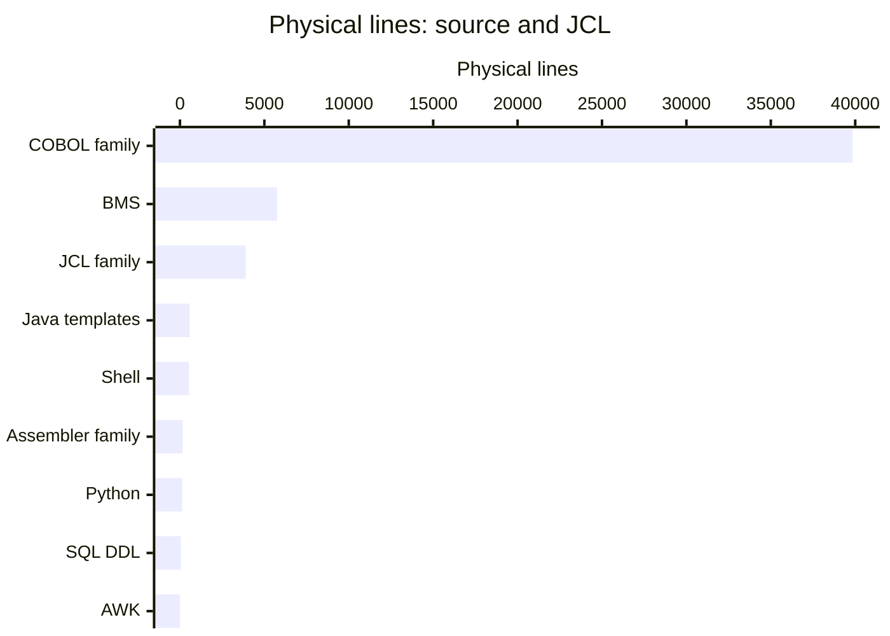

# By the numbers

Data collected on **2026-11-05**, the session's authoritative date, at commit `8ca2f6033dce5339b2aed95d6bd072efe196f5d3`. See [Lore](lore.md) for the dated changes behind these totals and [Testing](how-to-contribute/testing.md) for verification limits.

## Scope and counting rules

The inventory contains **339 git-tracked files**, totaling **7,893,510 bytes**. It excludes the untracked generated wiki and does not expand runtime ZIPs. These are repository files, not deployed services, workspace packages, or independently buildable monorepo applications.

Physical lines are newline-delimited lines, including comments and blank lines, with a final unterminated line counted once. Counts are not executable statements or logical SLOC. Filename extensions are matched case-insensitively; path-based data and metadata exclusions take precedence. Markdown code fences stay documentation. Java files are migration templates, not a working replacement application.

| Exclusive classification | Files | Physical lines |
|---|---:|---:|
| Source and source templates | 152 | 47,063 |
| Configuration and jobs | 82 | 5,529 |
| Documentation and legal | 20 | 5,944 |
| Catalog snapshot | 1 | 3,956 |
| Fixtures, not code | 22 | Not measured |
| Assets and runtime archives | 14 | Not measured |
| Empty metadata | 48 | 0 |
| **Total** | **339** | **62,492 measured text lines** |

Source includes COBOL programs, copybooks and Db2 declarations; BMS maps; assembler and macros; SQL DDL; shell, Python and AWK; and Java templates. Configuration includes JCL, procedures and the JCL template, utility control, CICS resources, IMS definitions, CA7 scheduling and Git ignore rules. Documentation includes Markdown and legal files. `app/catlg/LISTCAT.txt` is a catalog listing, not source.

All files under data directories are fixtures, including the ASCII samples under `app/data/ASCII`, the EBCDIC datasets under `app/data/EBCDIC`, and the IMS dataset under `app/app-authorization-ims-db2-mq/data/EBCDIC`. **EBCDIC bytes are not decoded or counted as code lines.** Fixture records and credentials are not reproduced. Metadata consists of 45 empty files under `scripts/markers` and three empty directory placeholders.

### Source, tests and configuration

There are **0 dedicated automated assertion-test files identified**, versus 152 source/template files: **0:152 by file count**, not a coverage percentage. The 82 configuration/job files include two host utility examples, `samples/jcl/REPRTEST.jcl` and `samples/jcl/SORTTEST.jcl`; their names do not make them an automated assertion suite. They remain configuration, avoiding double counting. `.factory/skills/cobol-to-java-conversion/scripts/generate-test-data.py` generates data rather than verifying program results. No checked-in CI workflow or general unit-test runner was found.

## Language and format mix

The chart groups related source formats and shows source plus JCL only; documentation, fixtures, resource/control definitions and assets are excluded from this chart.

| Language or format | Files | Physical lines | Classification |
|---|---:|---:|---|
| COBOL programs (`.cbl`) | 42 | 29,106 | Source |
| COBOL copybooks (`.cpy`), including symbolic maps | 61 | 10,548 | Source, including generated declarations |
| COBOL Db2 declarations (`.dcl`) | 3 | 192 | Source declarations |
| BMS maps | 21 | 5,756 | Source |
| Shell | 10 | 537 | Contributor/migration tooling |
| Python | 1 | 133 | Synthetic-data tooling |
| Java templates | 3 | 576 | Migration examples |
| Assembler | 2 | 114 | Source |
| Assembler macros | 2 | 43 | Source |
| SQL DDL | 6 | 53 | Schema source |
| AWK | 1 | 5 | Contributor tooling |
| JCL | 53 | 3,248 | Jobs, including samples |
| JCL procedures | 6 | 588 | Configuration |
| JCL template | 1 | 64 | Configuration template |
| CICS resource definitions | 4 | 685 | Configuration |
| Utility control | 8 | 253 | Configuration |
| IMS DBD | 4 | 135 | Configuration |
| IMS PSB | 4 | 88 | Configuration |
| CA7 schedule | 1 | 460 | Configuration |
| Git ignore | 1 | 8 | Configuration |
| Markdown | 18 | 5,768 | Documentation |
| Legal text | 2 | 176 | Documentation/legal |

The large COBOL-family total includes copybooks, repeated `COPY REPLACING` patterns and generated BMS symbolic maps. It does not represent 39,846 lines of independent business logic.

## Recent activity and churn

The complete reachable history has **30 commits**, including merge commits, from **2022-08-22** through **2026-01-11**. Monthly buckets below use author dates, not commit-arrival or deployment dates. November 2026 is partial, through the collection date.

| Month | Commits |
|---|---:|
| 2025-11 | 0 |
| 2025-12 | 0 |
| 2026-01 | 1 |
| 2026-02 | 0 |
| 2026-03 | 0 |
| 2026-04 | 0 |
| 2026-05 | 0 |
| 2026-06 | 0 |
| 2026-07 | 0 |
| 2026-08 | 0 |
| 2026-09 | 0 |
| 2026-10 | 0 |
| 2026-11, partial | 0 |

**Last 90 calendar days: 2026-08-08 through 2026-11-05 inclusive.** There are **0 commits, 0 changed files, 0 inserted lines and 0 deleted lines** in that interval. There is therefore no recent hotspot ranking to report. Historical change volume is not substituted for recent churn.

### Bot attribution

Across all 30 commits:

- Bot-named commit authors: **0/30 (0%)**.
- Bot-named committers: **0/30 (0%)**.
- `Co-authored-by` trailers found: **0**, including **0 bot trailers**.
- Commits with either a bot-named author or bot coauthor: **0/30 (0%)**.

Detection is a name heuristic: `[bot]`, the word `bot`, `factory-droid`, `dependabot`, `renovate`, or `github-actions`, case-insensitively, plus parsed coauthor trailers. It cannot infer AI assistance or automation attributed to ordinary names. Authors and committers are separate roles; neither individual rankings nor email addresses are published.

## Average file size by directory

These are recursive directory scopes, not package boundaries. Means use **bytes / tracked files**, including binary assets, fixtures and empty markers, rounded to one decimal byte. `app` is split at its immediate children; other top-level trees are grouped together, with the migration-skill path shown explicitly.

| Scope | Files | Total bytes | Mean bytes/file |
|---|---:|---:|---:|
| Root files | 6 | 37,455 | 6,242.5 |
| `.factory/skills/cobol-to-java-conversion` | 17 | 155,852 | 9,167.8 |
| `app/app-authorization-ims-db2-mq` | 40 | 536,879 | 13,422.0 |
| `app/app-transaction-type-db2` | 27 | 352,423 | 13,052.7 |
| `app/app-vsam-mq` | 4 | 99,955 | 24,988.8 |
| `app/asm` | 2 | 3,993 | 1,996.5 |
| `app/bms` | 17 | 279,832 | 16,460.7 |
| `app/catlg` | 1 | 195,621 | 195,621.0 |
| `app/cbl` | 29 | 1,111,090 | 38,313.4 |
| `app/cpy` | 29 | 127,546 | 4,398.1 |
| `app/cpy-bms` | 18 | 224,311 | 12,461.7 |
| `app/csd` | 2 | 29,940 | 14,970.0 |
| `app/ctl` | 1 | 1,061 | 1,061.0 |
| `app/data` | 22 | 339,249 | 15,420.4 |
| `app/jcl` | 36 | 142,775 | 3,966.0 |
| `app/maclib` | 2 | 1,972 | 986.0 |
| `app/proc` | 2 | 8,516 | 4,258.0 |
| `app/scheduler` | 1 | 23,815 | 23,815.0 |
| `diagrams` | 12 | 3,254,476 | 271,206.3 |
| `samples` | 15 | 952,862 | 63,524.1 |
| `scripts` | 56 | 13,887 | 248.0 |

The low mean for `scripts` reflects 45 empty transfer markers. The high mean for `samples` includes two runtime ZIPs; neither is expanded into language totals.

## Dependency and call complexity proxies

These lexical measurements cover the **42 COBOL program files**, not Markdown examples or copybooks recursively expanded by the compiler.

| Proxy | Sites |
|---|---:|
| Line-start `COPY` | 325 |
| Distinct `COPY` targets, case-insensitive | 64 |
| Line-start COBOL `CALL` | 60 |
| `EXEC SQL INCLUDE` | 11 |
| `EXEC CICS LINK` | 1 |
| `EXEC CICS XCTL` | 32 |

The scan drops fixed-format comment, page-eject and debug-indicator lines (`*`, `/`, `D` in column 7), examines columns 8–72, and matches the patterns above. Debug lines are excluded consistently, regardless of a host compiler's debug setting. `COPY` and `CALL` counts require the keyword at the start of the retained line; SQL/CICS patterns can span lines.

`app/cbl/COACTUPC.cbl` has the largest lexical `COPY` count: **54 sites**. Many are repeated attribute-copybook substitutions, not distinct dependencies. Eight distinct targets have no matching tracked `.cpy`/`.dcl` basename: `CMQGMOV`, `CMQMDV`, `CMQODV`, `CMQPMOV`, `CMQTML`, `CMQV`, `DFHAID`, and `DFHBMSCA`. These are consistent with external MQ/CICS copybooks; basename matching is not host include-path resolution.

This is **not** an exported-symbol count, transitive import-depth calculation, cyclomatic-complexity score, resolved call graph or runtime invocation count. Variable call/navigation targets, host libraries, `COPY REPLACING`, conditional compilation and translator behavior require a COBOL-aware build environment. `app/cbl/COBSWAIT.cbl`, for example, directly calls an assembler routine, while `app/cbl/COSGN00C.cbl` copies shared declarations and uses CICS navigation.

## Reproduction and limitations

The collection used `git ls-files -z` for the tracked path set, byte reads for sizes and newline counts, `git log HEAD` for all reachable commits and author-date buckets, and parsed commit trailers for bot attribution. `git ls-tree -r --name-only <commit>` supplies the historical file totals in [Lore](lore.md); `git blame --line-porcelain HEAD -- <path>` checks surviving lines. Directory and exclusive-category totals both reconcile to 339 files and 7,893,510 bytes.

The working-tree file bytes were measured against the tracked path list; these originals had no tracked modifications during collection. File history is bounded by the commits present here, not upstream activity after this checkout. No host job, transfer script, migration tool, fixture loader or application was executed. No runtime performance, coverage or service telemetry is inferred.
