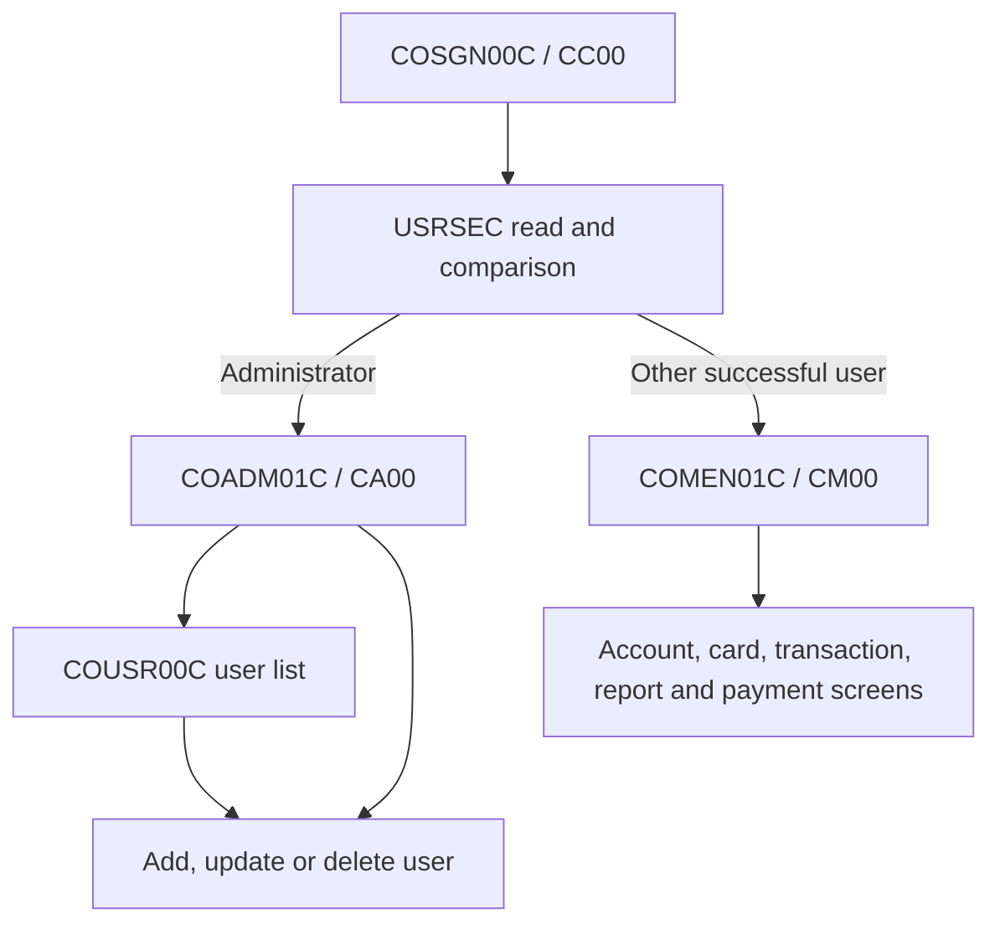

# Access, navigation and users

Active contributors: Arunkumar, Abhijit

## Purpose

Sign-on establishes application identity and routes the terminal to a regular-user or administrator menu. Administrators maintain the application security file. Return to [CardDemo features](index.md) for the other business flows.

## Key source files

| Key source file | CICS transaction | Responsibility |
| --- | --- | --- |
| `app/cbl/COSGN00C.cbl` | `CC00` | Sign-on, security-file lookup and role-based initial routing. |
| `app/cbl/COMEN01C.cbl` | `CM00` | Regular menu and dispatch to account, card, transaction, report and billing functions. |
| `app/cbl/COADM01C.cbl` | `CA00` | Administrator menu and dispatch. |
| `app/cbl/COUSR00C.cbl` | `CU00` | Ten-row user list with forward/backward paging and update/delete selections. |
| `app/cbl/COUSR01C.cbl` | `CU01` | Add a regular or administrator user with a CICS write. |
| `app/cbl/COUSR02C.cbl` | `CU02` | Read and rewrite an existing user. |
| `app/cbl/COUSR03C.cbl` | `CU03` | Read and delete an existing user. |

| Supporting source files | Contract |
| --- | --- |
| `app/cpy/CSUSR01Y.cpy` | `SEC-USER-DATA`, the application user/security record. |
| `app/cpy/COCOM01Y.cpy` | Identity, role, routing and shared screen context. |
| `app/cpy/COMEN02Y.cpy` | Regular-menu option count, labels, program names and option role flags. |
| `app/cpy/COADM02Y.cpy` | Administrator-menu option count, labels and program names. |
| `app/bms/COSGN00.bms`, `app/cpy-bms/COSGN00.CPY` | Sign-on mapset and symbolic map. |
| `app/bms/COMEN01.bms`, `app/cpy-bms/COMEN01.CPY` | Regular-menu mapset and symbolic map. |
| `app/bms/COADM01.bms`, `app/cpy-bms/COADM01.CPY` | Administrator-menu mapset and symbolic map. |
| `app/bms/COUSR00.bms`, `app/cpy-bms/COUSR00.CPY` | User-list mapset and symbolic map. |
| `app/bms/COUSR01.bms`, `app/cpy-bms/COUSR01.CPY` | User-add mapset and symbolic map. |
| `app/bms/COUSR02.bms`, `app/cpy-bms/COUSR02.CPY` | User-update mapset and symbolic map. |
| `app/bms/COUSR03.bms`, `app/cpy-bms/COUSR03.CPY` | User-delete mapset and symbolic map. |
| `app/csd/CARDDEMO.CSD`, `app/jcl/DUSRSECJ.jcl` | Runtime security-file mapping and sample security-file initialization job. |

## Sign-on and menu flow

1. `app/cbl/COSGN00C.cbl` receives `COSGN0A` from mapset `COSGN00`, rejects empty fields and uppercases the entered identity and password before lookup/comparison.
2. It reads CICS file `USRSEC` by user ID and compares the stored application password directly. Successful lookup puts the ID and role into `CARDDEMO-COMMAREA`.
3. Role `A` transfers control to `COADM01C`; other successful users transfer to `COMEN01C`. The shared copybook defines `A` and `U` role conditions.
4. Menus validate the numeric option against the configured count, set caller/context fields, then `XCTL` the selected program with the communication area.
5. `RETURN TRANSID ... COMMAREA ...` ends a CICS task while preserving the next interaction's context. On reentry, programs receive the map and interpret `EIBAID`.

The regular menu has 11 configured entries in `app/cpy/COMEN02Y.cpy`. Its option-role check supports administrator-only entries, but the current entries are marked `U`, including transaction entry. Do not infer an administrator-only transaction-add restriction from an older commented label.

The pending-authorization menu entry is a link to the [optional authorization module](../../systems/authorizations/index.md). `app/cbl/COMEN01C.cbl` checks whether that program exists with `INQUIRE PROGRAM` before transfer. The administrator menu also names [optional Db2 transaction-type programs](../../systems/transaction-types.md); do not assume the same installation check exists for every menu option.

## User maintenance flow

`app/cbl/COUSR00C.cbl` maintains first/last keys, page number and next-page state in its communication-area extension. PF7/PF8 navigate the list; PF3 returns to the administrator menu. Row selections pass the chosen user to update or delete through `XCTL`.

The add/update/delete programs use `app/cpy/CSUSR01Y.cpy` and operate on `USRSEC`. Their screens collect or display the relevant user fields; writes, rewrites and deletes are CICS file operations with response handling. This is application-level user maintenance, not provisioning a RACF identity.

## Integration and modification pointers

- **Add a regular-menu feature:** change `app/cpy/COMEN02Y.cpy`, preserving option count, table shape and program-name width; implement/register the target and update the menu map if the display requires it.
- **Add an administrator option:** coordinate `app/cpy/COADM02Y.cpy`, `app/cbl/COADM01C.cbl` and the target resources. A configured label alone does not install a module.
- **Change authentication:** start in `READ-USER-SEC-FILE` and `PROCESS-ENTER-KEY` in `app/cbl/COSGN00C.cbl`, then inspect every security-record consumer. Never use or reproduce checked-in fixture credentials in documentation.
- **Change user fields:** update `app/cpy/CSUSR01Y.cpy`, all four maintenance programs, their BMS/symbolic maps and the initialization job's record contract together.
- **Change navigation:** preserve the common communication-area prefix and any appended list state; inspect no-COMMAREA handling and PF3 return destinations.

The sign-on comparison and menu routing are demonstration controls, not a comprehensive authorization boundary. See [security](../../security.md) before exposing the application or using realistic data.

## Bounded source statistics and verification

Scope: exactly the seven `app/cbl` files in the first table, excluding maps, copybooks, JCL and optional modules. There are **seven program files**, **two distinct human committer identities** in their `origin/main` history, and **0 automated test files : 7 program files (0%)**. Service committer identities are excluded; contributor bylines use named authors rather than ownership claims.

No host session or automated tests were run for this documentation. Host verification should cover invalid/unknown sign-on, regular/admin routing, invalid menu options, paging boundaries and add/update/delete response paths with synthetic users. See [testing](../../how-to-contribute/testing.md).
