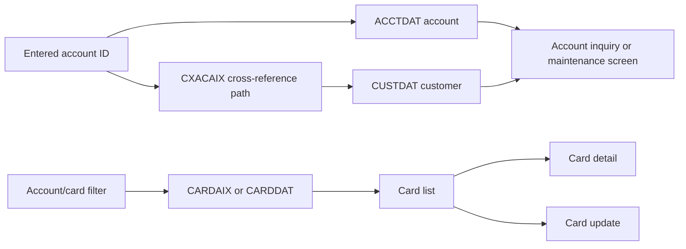

# Accounts and cards

Active contributors: Arunkumar, Sanjay, Abhijit

## Purpose

These screens join account, customer and card information through VSAM keys and cross-references. Account maintenance includes customer details; card maintenance is a separate flow. Return to [CardDemo features](index.md) or continue to [transactions and billing](transactions-and-billing.md).

## Key source files

| Key source file | Transaction | Behavior |
| --- | --- | --- |
| `app/cbl/COACTVWC.cbl` | `CAVW` | Validate an account ID, resolve its cross-reference, read account/customer data and populate the inquiry screen. |
| `app/cbl/COACTUPC.cbl` | `CAUP` | Validate, confirm and save account and customer changes. |
| `app/cbl/COCRDLIC.cbl` | `CCLI` | Seven-row card list, account/card filtering, forward/backward browsing and row navigation. |
| `app/cbl/COCRDSLC.cbl` | `CCDL` | Card detail inquiry with account/card-key validation. |
| `app/cbl/COCRDUPC.cbl` | `CCUP` | Validate, confirm and rewrite card details. |

| Supporting source files | Contract |
| --- | --- |
| `app/cpy/CVACT01Y.cpy` | 300-byte account record, 11-digit account key, balances, limits, dates, status and disclosure group. |
| `app/cpy/CVACT02Y.cpy` | 150-byte card record, 16-character card key and account association. |
| `app/cpy/CVACT03Y.cpy` | 50-byte card-to-customer/account cross-reference. |
| `app/cpy/CVCUS01Y.cpy` | 500-byte customer record and nine-digit customer key. |
| `app/cpy/COCOM01Y.cpy`, `app/cpy/CVCRD01Y.cpy` | Shared navigation/entity context and card-screen work areas. |
| `app/cpy/CSLKPCDY.cpy`, `app/cpy/CSUTLDWY.cpy`, `app/cpy/CSUTLDPY.cpy` | Lookup/validation data and date-validation working fields/paragraphs used by account maintenance. |
| `app/cpy/CSSETATY.cpy` | Reusable BMS attribute-setting text expanded with `COPY ... REPLACING`. |
| `app/bms/COACTVW.bms`, `app/cpy-bms/COACTVW.CPY` | Account-view mapset and symbolic map. |
| `app/bms/COACTUP.bms`, `app/cpy-bms/COACTUP.CPY` | Account-update mapset and symbolic map. |
| `app/bms/COCRDLI.bms`, `app/cpy-bms/COCRDLI.CPY` | Card-list mapset and symbolic map. |
| `app/bms/COCRDSL.bms`, `app/cpy-bms/COCRDSL.CPY` | Card-detail mapset and symbolic map. |
| `app/bms/COCRDUP.bms`, `app/cpy-bms/COCRDUP.CPY` | Card-update mapset and symbolic map. |
| `app/csd/CARDDEMO.CSD` | CICS file names and dataset paths. |
| `app/jcl/ACCTFILE.jcl`, `app/jcl/CUSTFILE.jcl` | Account/customer initialization examples. |
| `app/jcl/CARDFILE.jcl`, `app/jcl/XREFFILE.jcl` | Card/cross-reference initialization and alternate-index setup. |

## Data access and inquiry flow

Online resource names are meaningful:

- `ACCTDAT`: account primary-key access.
- `CUSTDAT`: customer primary-key access.
- `CARDDAT`: card primary-key access.
- `CARDAIX`: card alternate-index path for account-oriented access.
- `CCXREF`: card-keyed customer/account cross-reference.
- `CXACAIX`: cross-reference alternate-index path keyed by account.

Mappings are declared in `app/csd/CARDDEMO.CSD`, while dataset/index definitions live in the JCL listed above.

In `app/cbl/COACTVWC.cbl`, `9200-GETCARDXREF-BYACCT`, `9300-GETACCTDATA-BYACCT` and `9400-GETCUSTDATA-BYCUST` make the account/customer join explicit. The screen does not represent a separate customer database service.

`app/cbl/COCRDLIC.cbl` implements separate forward and backward browsing routines, then filters records for the requested account/card. Its seven-row screen state is not a promise that all matching cards fit on one screen. `app/cbl/COCRDSLC.cbl` supplies direct detail lookup paths for account/card inputs.

## Update state and concurrency

Both update programs distinguish initial display, changed input, validated-but-unconfirmed changes and confirmed save. They keep old and proposed values across pseudo-conversational turns rather than treating each Enter as an unconditional update.

For account/customer changes, `9600-WRITE-PROCESSING` in `app/cbl/COACTUPC.cbl`:

1. Reads the account with `UPDATE`.
2. Reads the associated customer with `UPDATE`.
3. Calls `9700-CHECK-CHANGE-IN-REC` to compare current records with the earlier snapshot.
4. Builds replacement account/customer records and attempts the rewrites.

The program contains syncpoint and rollback handling; inspect those branches when changing the two-record save. Do not equate the demo CSD's `RECOVERY(NONE)` resources with a production recovery guarantee.

For card changes, `9200-WRITE-PROCESSING` in `app/cbl/COCRDUPC.cbl` locks `CARDDAT`, calls `9300-CHECK-CHANGE-IN-REC`, builds `CARD-UPDATE-RECORD` and rewrites it. The explicit editable validation routines cover name, active status and expiry month/year. Preserve the old/new record comparison when extending fields: validation before confirmation alone does not detect another task's intervening change.

## Integration and modification pointers

- **Account field or validation rule:** start in `1200-EDIT-MAP-INPUTS` and the `1210`–`1280` edit routines in `app/cbl/COACTUPC.cbl`; also inspect screen receive/population, old/new comparison, update-record construction and both account maps.
- **Customer field:** follow the same account-update path and `app/cpy/CVCUS01Y.cpy`; the statement program also consumes a customer layout in `app/cpy/CUSTREC.cpy`.
- **Card field:** coordinate `app/cpy/CVACT02Y.cpy`, detail/list/update rendering and `app/cbl/COCRDUPC.cbl` snapshot comparisons and replacement record.
- **Account/card relationship or key:** inspect both alternate-index definitions and `app/cpy/CVACT03Y.cpy`; billing, posting, interest and reporting also resolve these relationships.
- **Record layout:** preserve signed-display numeric and date encodings, record lengths and positional consumers. See [data models](../../reference/data-models.md) and [batch processing](batch-processing.md).

Avoid using diagnostic reader output as a safe public example: these records contain personal and card-related fields. The [security page](../../security.md) explains demonstration limits.

## Bounded source statistics and verification

Scope: exactly the five `app/cbl` files in the first table, excluding their maps, copybooks and jobs. There are **five program files**, **two distinct human committer identities** in `origin/main` history after excluding the GitHub service identity, and **0 automated test files : 5 program files (0%)**. Byline names are historical authors, not formal owners.

No host execution was performed. Suggested synthetic-data checks are missing account/card/customer, inconsistent account/card keys, first/last list pages, invalid numeric/date/status inputs, confirmation/cancel and a concurrent edit between initial display and save. These are verification targets, not a checked-in test suite.
