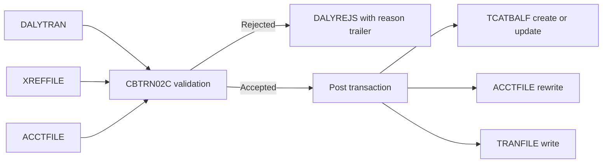

# Batch processing and output

Active contributors: Arunkumar, Sanjay, Abhijit

## Purpose

Core batch programs read host datasets, post daily transactions, compute demonstration interest and generate reports and statements. JCL also initializes or recreates datasets and indexes. These are different operational activities: an initialization example is not a safe daily production runbook. Return to [CardDemo features](index.md).

## Key source files

| Key source file | Role and checked-in job relationship |
| --- | --- |
| `app/cbl/CBACT01C.cbl` | Account reader/export demonstration, called by `app/jcl/READACCT.jcl`; writes sequential, array-shaped and variable-record outputs and calls assembler `COBDATFT`. |
| `app/cbl/CBACT02C.cbl` | Sequential card reader/display, called by `app/jcl/READCARD.jcl`. |
| `app/cbl/CBACT03C.cbl` | Sequential cross-reference reader/display, called by `app/jcl/READXREF.jcl`. |
| `app/cbl/CBCUS01C.cbl` | Sequential customer reader/display, called by `app/jcl/READCUST.jcl`. |
| `app/cbl/CBTRN01C.cbl` | Daily-transaction read/lookup example. Despite its posting header, its mainline displays input and performs cross-reference/account lookups; it is not the `POSTTRAN` job's posting implementation. |
| `app/cbl/CBTRN02C.cbl` | Actual `app/jcl/POSTTRAN.jcl` program: validation, rejects, category/account updates and master transaction writes. |
| `app/cbl/CBACT04C.cbl` | Interest calculator called by `app/jcl/INTCALC.jcl`; updates accounts and writes sequential system transactions. |
| `app/cbl/CBTRN03C.cbl` | Transaction-detail report program used by `app/jcl/TRANREPT.jcl` and `app/proc/TRANREPT.prc`. |
| `app/cbl/CBSTM03A.CBL` | Statement formatter called by `app/jcl/CREASTMT.JCL`; generates text and HTML. |
| `app/cbl/CBSTM03B.CBL` | Statement file-I/O subroutine called by `app/cbl/CBSTM03A.CBL`. |

The readers print data and file statuses; they are diagnostics/demonstrations, not tests. Treat their output as sensitive. Utility `app/cbl/COBSWAIT.cbl` and its `app/jcl/WAITSTEP.jcl` caller are covered in [host utilities](../../systems/utilities.md).

## Daily posting

`app/jcl/POSTTRAN.jcl` binds `CBTRN02C` to:

| DD name | Role |
| --- | --- |
| `DALYTRAN` | Sequential daily input, layout `app/cpy/CVTRA06Y.cpy`. |
| `TRANFILE` | Indexed transaction master, layout `app/cpy/CVTRA05Y.cpy`. |
| `XREFFILE` | Card-to-account cross-reference, layout `app/cpy/CVACT03Y.cpy`. |
| `ACCTFILE` | Account master, layout `app/cpy/CVACT01Y.cpy`. |
| `TCATBALF` | Account/type/category balances, layout `app/cpy/CVTRA01Y.cpy`. |
| `DALYREJS` | New reject generation containing the original input and a validation trailer. |



`1500-VALIDATE-TRAN` calls cross-reference and account lookups. The implemented reasons include:

| Reason | Source behavior |
| --- | --- |
| `100` | Card cross-reference missing. |
| `101` | Account missing. |
| `102` | Computed balance exceeds the account credit limit. |
| `103` | Transaction origin date is after account expiry. |

The limit comparison uses `ACCT-CURR-CYC-CREDIT - ACCT-CURR-CYC-DEBIT + DALYTRAN-AMT`. This is the implemented formula, not a generalized available-credit definition. The source explicitly leaves room for additional validation.

`2000-POST-TRANSACTION` copies input fields, sets a processing timestamp, then updates category balance, updates account and writes the master transaction—in that order. `2800-UPDATE-ACCOUNT-REC` adds the signed amount to current balance; nonnegative amounts are added to current-cycle credit and negative amounts to current-cycle debit. Preserve these actual signs when changing downstream calculations.

Batch file operations are not a CICS unit of work. There is no demonstrated transactional replay/checkpoint protocol spanning those three writes. Reconcile files and reject output after a failure before deciding how to restart; blindly rerunning input can repeat balance effects.

## Interest and system transactions

`app/cbl/CBACT04C.cbl` reads category balances in account-key order, reads account and account-oriented cross-reference data, and looks up rates in the disclosure-group file described by `app/cpy/CVTRA02Y.cpy`. If an account-group/type/category rate is absent, it retries the lookup with group `DEFAULT`; failure of the default lookup takes the error path.

`1300-COMPUTE-INTEREST` implements:

```text
monthly interest = transaction category balance × disclosure interest rate / 1200
```

For nonzero rates it accumulates interest and writes system transactions through `1300-B-WRITE-TX`. Transaction IDs combine the ten-character JCL parameter with a six-digit suffix. The emitted record uses transaction type `01`, category `0005` and source `System`; `app/jcl/INTCALC.jcl` directs it to a new `SYSTRAN` generation, not directly to the indexed master.

`1050-UPDATE-ACCOUNT` adds accumulated interest and clears current-cycle credit/debit. Account-boundary and end-of-file control flow determine when that routine runs; final-account and empty-input behavior require explicit host verification, not an assumption that the routine is called for every possible input shape. `1400-COMPUTE-FEES` is a placeholder marked “To be implemented,” not an implemented fee engine.

`app/jcl/COMBTRAN.jcl` sorts the current transaction backup together with system transactions by transaction ID, writes a combined generation and reloads the transaction master using IDCAMS. Inspect the immediately preceding backup/redefinition steps before running it.

## Transaction and category reports

`app/jcl/TRANREPT.jcl` and `app/proc/TRANREPT.prc` provide related standalone and callable report paths:

1. Copy the transaction master with `REPROC`.
2. SORT by card and include records whose processing date falls within the selected bounds.
3. Run `CBTRN03C` on the selected sequential records.
4. Supply cross-reference, transaction-type and transaction-category VSAM files plus `DATEPARM`.
5. Write formatted report output, with page, account and grand-total structures from `app/cpy/CVTRA07Y.cpy`.

Descriptions come from `app/cpy/CVTRA03Y.cpy` and `app/cpy/CVTRA04Y.cpy` reference-record layouts. The procedure also has positional symbols for fields inside the 350-byte master record. Online report requests supply overrides from embedded JCL in `app/cbl/CORPT00C.cbl`; see [transactions and billing](transactions-and-billing.md#report-request-integration).

`app/proc/REPROC.prc` delegates IDCAMS control to `app/ctl/REPROCT.ctl`, whose operative statement is `REPRO INFILE(FILEIN) OUTFILE(FILEOUT)`. The caller provides the datasets. `app/jcl/PRTCATBL.jcl` is a separate SORT-formatted category-balance report, not a `CBTRN03C` run.

## Statement production

`app/jcl/CREASTMT.JCL` sorts/reformats transaction data so card number precedes transaction ID, then loads a statement-oriented indexed file. The reordered layout is `app/cpy/COSTM01.CPY`; it is not the ordinary transaction-master key contract.

`app/cbl/CBSTM03A.CBL` opens/loads transaction data, walks cross-reference records, fetches customer/account records and writes statement headers, transaction rows and totals. Text output records are 80 characters; HTML output records are 100 characters. Its customer copybook is `app/cpy/CUSTREC.cpy`, so a customer-layout change must check that consumer as well as `app/cpy/CVCUS01Y.cpy`.

The formatter calls `app/cbl/CBSTM03B.CBL` using a block containing DD selector, operation, return status, key/key length and a record buffer. The subroutine dispatches among `TRNXFILE`, `XREFFILE`, `CUSTFILE` and `ACCTFILE`; sequential transaction/cross-reference reads and keyed customer/account reads are separate operations.

The formatter deliberately exercises host-specific constructs, including control-block addressing, `ALTER`/`GO TO`, packed/binary numerics and a two-dimensional table. The declared transaction cache has 51 card entries and ten transaction entries per card. These are fixed implementation bounds, not a scalable statement-service guarantee; inspect indexing and overflow behavior before increasing workload.

`app/jcl/TXT2PDF1.JCL` invokes external TXT2PDF libraries against the text statement. The checked-in formatter itself produces text and HTML, not native PDF; availability of that external conversion tooling is environment-dependent.

## Scheduling and the online window

`app/scheduler/CardDemo.ca7` is a CA7 `LJOB` listing with triggered-job relationships, not executable application code or evidence of a currently running scheduler.

Its displayed initialization chain uses schedule ID `030`:

```text
CLOSEFIL → ACCTFILE → CARDFILE → XREFFILE → CUSTFILE
         → TRANBKP → DISCGRP → TCATBALF → TRANTYPE
         → DUSRSECJ → POSTTRAN → INTCALC
```

The listing then shows `INTCALC` triggering `TRANBKP` with `SCHID=031`; the following `TRANBKP`/`COMBTRAN` entries lead to `CREASTMT`. Further listed triggers use `SCHID=032` for another `COMBTRAN`/`CREASTMT` segment, then `TRANIDX → OPENFIL`. Some jobs appear more than once. Preserve those schedule-ID distinctions when interpreting or rebuilding the example; flattening it into one unconditional daily chain loses information.

`app/jcl/CLOSEFIL.jcl` and `app/jcl/OPENFIL.jcl` use SDSF to issue CICS file close/open commands for a named example region. Their explicit file set is `TRANSACT`, `CCXREF`, `ACCTDAT`, `CXACAIX` and `USRSEC`; it is not every core VSAM resource. Other initialization members contain their own close/open steps. Determine the full affected resource set and actual host permissions before any maintenance window.

## JCL families and supporting sources

| Key source files | Purpose and caution |
| --- | --- |
| `app/jcl/ACCTFILE.jcl`, `app/jcl/CARDFILE.jcl`, `app/jcl/XREFFILE.jcl`, `app/jcl/CUSTFILE.jcl` | Master-data definition/load examples; include delete/recreate operations and relevant index setup. |
| `app/jcl/TRANFILE.jcl`, `app/jcl/TRANIDX.jcl` | Transaction master and alternate-index setup/rebuild. |
| `app/jcl/DISCGRP.jcl`, `app/jcl/TCATBALF.jcl`, `app/jcl/TRANTYPE.jcl`, `app/jcl/TRANCATG.jcl` | Disclosure, category balance and reference-file initialization. |
| `app/jcl/TRANBKP.jcl`, `app/jcl/COMBTRAN.jcl` | Backup plus master delete/redefinition, then combine/reload; a job called backup is not necessarily read-only. |
| `app/jcl/DEFGDGB.jcl`, `app/jcl/DEFGDGD.jcl`, `app/jcl/DALYREJS.jcl`, `app/jcl/REPTFILE.jcl` | Generation bases and output/reference-backup setup. |
| `app/jcl/DEFCUST.jcl`, `app/jcl/DUSRSECJ.jcl`, `app/jcl/ESDSRRDS.jcl` | Additional definition/security initialization and ESDS/RRDS demonstration, not new online business features. |
| `app/jcl/READACCT.jcl`, `app/jcl/READCARD.jcl`, `app/jcl/READXREF.jcl`, `app/jcl/READCUST.jcl` | Diagnostic reader invocations; account output setup also deletes earlier generated outputs. |
| `app/jcl/POSTTRAN.jcl`, `app/jcl/INTCALC.jcl` | Daily posting and interest program DD bindings. |
| `app/jcl/TRANREPT.jcl`, `app/proc/TRANREPT.prc`, `app/jcl/PRTCATBL.jcl` | Transaction and category report paths. |
| `app/jcl/CREASTMT.JCL`, `app/jcl/TXT2PDF1.JCL` | Statement preparation/generation and external PDF conversion example. |
| `app/jcl/CLOSEFIL.jcl`, `app/jcl/OPENFIL.jcl`, `app/scheduler/CardDemo.ca7` | Example online/batch coordination. |
| `app/proc/REPROC.prc`, `app/ctl/REPROCT.ctl` | Reusable IDCAMS copy procedure and control member. |
| `app/jcl/CBADMCDJ.jcl` | CICS resource-definition maintenance with `DFHCSDUP`. |
| `app/jcl/INTRDRJ1.JCL`, `app/jcl/INTRDRJ2.JCL`, `app/jcl/FTPJCL.JCL`, `app/jcl/WAITSTEP.jcl` | Internal-reader, transfer and wait examples; see [tooling](../../how-to-contribute/tooling.md) rather than treating these as business processing. |

## Modification entry points

- **Posting rules:** change `1500-VALIDATE-TRAN` and its lookup routines in `app/cbl/CBTRN02C.cbl`; coordinate reject reason/trailer handling and all three accepted-write steps.
- **Interest policy:** inspect rate keys/default lookup, numeric precision, account grouping/reset behavior and system-transaction IDs in `app/cbl/CBACT04C.cbl`; the fee paragraph currently does nothing.
- **Report layout/filter:** coordinate `app/cbl/CBTRN03C.cbl`, `app/cpy/CVTRA07Y.cpy`, both report JCL/procedure paths and online embedded overrides.
- **Statement layout:** edit `app/cbl/CBSTM03A.CBL`; for file-operation changes also update `app/cbl/CBSTM03B.CBL` and both copies of its parameter contract.
- **Any record change:** audit literal SORT offsets and IDCAMS record/key lengths, not just `COPY` consumers. See [data models](../../reference/data-models.md).

For host prerequisites and operational caveats see [deployment](../../deployment.md), [configuration](../../reference/configuration.md) and [debugging](../../how-to-contribute/debugging.md).

## Bounded source statistics and verification

Program scope: exactly the ten `app/cbl` files in the coverage table. It contains **ten program files**, **two distinct human committer identities** in `origin/main` history after excluding the GitHub service identity, and **0 automated test files : 10 program files (0%)**. A separate supporting scope (`app/jcl`, `app/proc`, `app/ctl`, `app/scheduler`) contains **40 files**: 36 jobs, two procedures, one control member and one schedule. These counts exclude optional modules and sample compilation jobs.

No JCL, transfer script or batch program was executed. Suggested host checks include reject reasons and output lengths, duplicate IDs, partial failure/restart reconciliation, interest account boundaries/EOF/default-rate behavior, report inclusive date limits and totals, statement-table bounds, alternate-index rebuild and reopening every affected CICS resource. They are proposed verification work, not invented repository tests.
