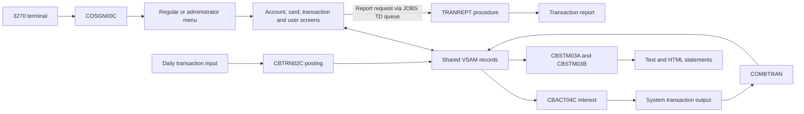

# CardDemo features

Active contributors: Sanjay, Arunkumar, Abhijit

## Purpose

The core application demonstrates credit-card administration through CICS terminal screens and COBOL batch jobs sharing VSAM data. It is a demonstration, not a production banking or payment service. Start with [architecture](../../overview/architecture.md) for runtime boundaries.

Read this feature area in order:

1. [Access, navigation and users](access-and-users.md): sign-on, role-specific menus and security-file maintenance.
2. [Accounts and cards](accounts-and-cards.md): account/customer inquiry and updates, card browsing and maintenance.
3. [Transactions and billing](transactions-and-billing.md): transaction inquiry and entry, full-balance payment and report requests.
4. [Batch processing and output](batch-processing.md): posting, interest, file maintenance, reports, statements and the CA7 example.

## Runtime flow

This is a data-flow diagram, not a safe execution order. The [batch page](batch-processing.md#scheduling-and-the-online-window) distinguishes destructive initialization from repeat processing.

## Abstractions and integration

- The communication area in `app/cpy/COCOM01Y.cpy` carries caller/destination, user role, customer, account, card and screen context. Several programs append their own state after this shared prefix.
- Each online program uses a BMS mapset in `app/bms` and a symbolic input/output layout in `app/cpy-bms`. Changing a screen means keeping all three representations aligned.
- CICS file names and batch DD names are different interfaces to related datasets. For example, online `ACCTDAT` corresponds to the account dataset supplied through batch `ACCTFILE`; resource mappings are in `app/csd/CARDDEMO.CSD`.
- Account, card, customer, cross-reference and transaction copybooks are contracts shared by online programs, batch programs and positional SORT controls. See [data models](../../reference/data-models.md).
- Menu entries are not proof that an optional module is installed. Follow [authorizations](../../systems/authorizations/index.md), [transaction types](../../systems/transaction-types.md) and [MQ inquiries](../../systems/mq-inquiries.md) for extensions; their internals are outside this core area.

## Program coverage

| Area | Core program files covered |
| --- | ---: |
| [Access and users](access-and-users.md) | 7 |
| [Accounts and cards](accounts-and-cards.md) | 5 |
| [Transactions and billing](transactions-and-billing.md) | 5 |
| [Batch processing](batch-processing.md) | 10 |
| Shared utility entry points below | 2 |
| Total in `app/cbl` | 29 |

## Key source files

The two shared programs are not separate business features:

| Key source file | Responsibility and caller |
| --- | --- |
| `app/cbl/CSUTLDTC.cbl` | Date validation through Language Environment `CEEDAYS`; called by transaction entry and report requests. |
| `app/cbl/COBSWAIT.cbl` | Converts the supplied wait parameter for the assembler `MVSWAIT` routine; used by `app/jcl/WAITSTEP.jcl`. |
| `app/cpy/CODATECN.cpy` | Interface to date-formatting assembler called by the account reader. |
| `app/cpy/CSDAT01Y.cpy`, `app/cpy/COTTL01Y.cpy`, `app/cpy/CSMSG01Y.cpy` | Shared screen date/time, titles and messages. |
| `app/cpy/CSMSG02Y.cpy`, `app/cpy/CSSTRPFY.cpy` | Diagnostic data and reusable paragraph text used by the larger account/card programs. |
| `app/cpy/CVCRD01Y.cpy` | Shared account/card working fields and AID-key definitions. |

See [host utilities](../../systems/utilities.md) for utility interfaces, not an alternative application entry point. `app/cpy/UNUSED1Y.cpy` is a placeholder copybook, not an additional feature.

## Modification entry points

Choose a child page before changing behavior. For a new menu option, update menu data, target program, mapset and CICS definitions together. For a record change, inspect both online and batch consumers and every byte-position-dependent JCL control. For scheduling changes, inspect the individual JCL as well as `app/scheduler/CardDemo.ca7`; the schedule is an example listing, not a deployment guarantee.

Use [patterns and conventions](../../how-to-contribute/patterns-and-conventions.md), [configuration](../../reference/configuration.md) and [testing](../../how-to-contribute/testing.md) for cross-cutting rules.

## Bounded source statistics

At the `origin/main` snapshot used here (`8ca2f60`), the exact scope `app/cbl`, `app/bms`, `app/cpy`, `app/cpy-bms`, `app/jcl`, `app/proc`, `app/ctl` and `app/scheduler` contains **132 tracked files**, excluding `app/cpy-bms/.gitkeep`: 29 COBOL programs, 17 maps, 29 shared copybooks, 17 symbolic maps, 36 jobs, two procedures, one control member and one schedule listing.

History for that scope contains **two distinct human committer identities** after excluding the GitHub service identity, using `git log origin/main --format='%cN' -- <scope>`. This is an attribution count, not ownership or a bus-factor estimate. Contributor bylines use named human authors from the same default-branch history; handles are not expanded into guessed names.

The program-file test-to-code ratio is **0:29 (0%)**: no automated test files were found in this bounded source scope. Sample data, diagnostic readers and JCL examples are not tests, and this is not a coverage measurement.
