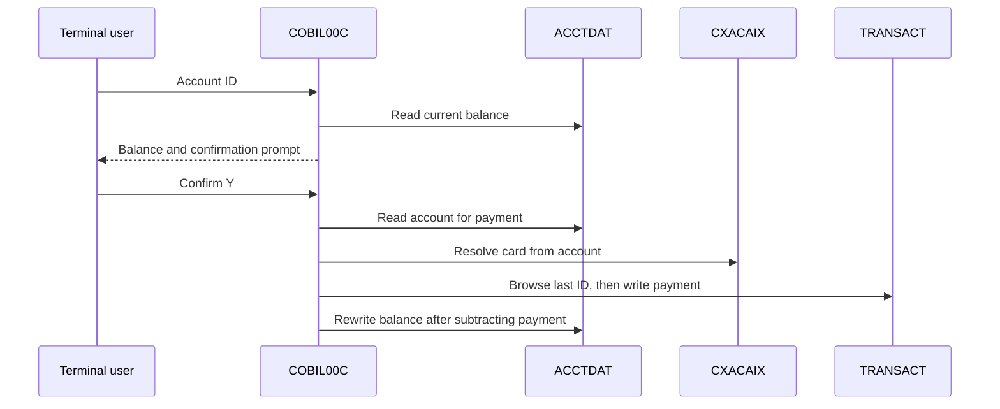

# Transactions and billing

Active contributors: Abhijit

## Purpose

Regular-menu screens browse the transaction master, show individual records, add a transaction, pay an account's full current balance and request transaction reports. Return to [CardDemo features](index.md); batch posting and report execution are covered in [batch processing](batch-processing.md).

## Key source files

| Key source file | Transaction | Behavior |
| --- | --- | --- |
| `app/cbl/COTRN00C.cbl` | `CT00` | Transaction list, key-based starting position, paging and row selection. |
| `app/cbl/COTRN01C.cbl` | `CT01` | Read and display one `TRANSACT` record. |
| `app/cbl/COTRN02C.cbl` | `CT02` | Validate and confirm a new transaction, assign an ID and write the master. |
| `app/cbl/COBIL00C.cbl` | `CB00` | Confirm full-balance payment, write a payment transaction and update the account balance. |
| `app/cbl/CORPT00C.cbl` | `CR00` | Select report dates, validate confirmation and submit report JCL through a transient-data queue. |

| Supporting source files | Contract |
| --- | --- |
| `app/cpy/CVTRA05Y.cpy` | 350-byte master transaction record, 16-character transaction ID, type/category, amount, card and timestamps. |
| `app/cpy/CVACT01Y.cpy`, `app/cpy/CVACT03Y.cpy` | Account balance and card/account cross-reference. |
| `app/cpy/COCOM01Y.cpy` | Shared identity/routing context; list/detail flows append selection state. |
| `app/cbl/CSUTLDTC.cbl` | Date validation using `CEEDAYS`; called by transaction entry and report selection. |
| `app/bms/COTRN00.bms`, `app/cpy-bms/COTRN00.CPY` | Transaction-list mapset and symbolic map. |
| `app/bms/COTRN01.bms`, `app/cpy-bms/COTRN01.CPY` | Transaction-detail mapset and symbolic map. |
| `app/bms/COTRN02.bms`, `app/cpy-bms/COTRN02.CPY` | Transaction-entry mapset and symbolic map. |
| `app/bms/COBIL00.bms`, `app/cpy-bms/COBIL00.CPY` | Bill-payment mapset and symbolic map. |
| `app/bms/CORPT00.bms`, `app/cpy-bms/CORPT00.CPY` | Report-request mapset and symbolic map. |
| `app/proc/TRANREPT.prc`, `app/jcl/TRANREPT.jcl` | Submitted-report procedure and standalone report job example. |
| `app/csd/CARDDEMO.CSD` | Online file, transaction/program and report-output queue resources. |

## Inquiry and entry flows

`app/cbl/COTRN00C.cbl` stores page number, first/last keys and selected transaction in its communication-area extension. PF7/PF8 browse backward/forward; selecting `S` on a row transfers to `COTRN01C`. The detail program reads `TRANSACT` by transaction ID.

Transaction entry in `app/cbl/COTRN02C.cbl` validates key fields, account/card relationships and required transaction details, including dates through `app/cbl/CSUTLDTC.cbl`. The AID dispatch includes clear and copy-last-data actions. After confirmation, `ADD-TRANSACTION`:

1. Starts a browse at a high-valued transaction key.
2. Reads backward to obtain the last transaction ID and ends the browse.
3. Treats that ID as numeric and increments it.
4. Populates `TRAN-RECORD` from the screen and writes `TRANSACT`.

This is a direct master-file write, not submission to the daily posting input. The add routine does not perform the batch posting program's account/category-balance updates. Do not describe all transaction entry paths as one interchangeable accounting operation.

The last-key-plus-one allocation is visible source behavior, not a globally unique-ID service. Concurrent additions, an empty master and a nonnumeric last key are important host verification cases.

## Bill-payment flow

`PROCESS-ENTER-KEY` in `app/cbl/COBIL00C.cbl` accepts `Y/N` confirmation and refuses a nonpositive balance. For a confirmed positive balance it creates a transaction with type `02`, category `0002`, the full current balance as amount, and the online bill-payment description. It then subtracts that amount from the account's current balance.

There is no partial-payment amount entry or external payment-network call in this flow. Its payment amount/sign behavior should be understood from this routine, not inferred from batch transaction signs. Response handling and host recovery configuration must be reviewed before claiming atomicity or safe replay.

## Report-request integration

`app/cbl/CORPT00C.cbl` offers monthly, yearly and custom date selections. Custom date fields are validated through `CSUTLDTC`; selected dates populate both SORT symbols and the report program's date parameters in embedded JCL.

After confirmation, `SUBMIT-JOB-TO-INTRDR` iterates the generated 80-character JCL records. `WIRTE-JOBSUB-TDQ` writes them with `EXEC CICS WRITEQ TD QUEUE('JOBS')`. The embedded job invokes `app/proc/TRANREPT.prc` from a configured host procedure library.

A successful queue write is submission, not proof that JES ran the job or produced a correct report. The actual sort, reference-file lookups and report records are described in [batch reports](batch-processing.md#transaction-and-category-reports).

## Modification entry points

- **New transaction field:** update `app/cpy/CVTRA05Y.cpy`, list/detail/add screens, their symbolic maps, batch input/output layouts and every SORT position derived from the 350-byte record.
- **New entry validation:** use the validation routines before `ADD-TRANSACTION`; do not assume a numeric type/category was checked against a reference file simply because report jobs later read those files.
- **Payment semantics:** inspect the payment record construction, transaction-ID allocation, account read/rewrite and error branches together in `app/cbl/COBIL00C.cbl`.
- **Report dates or host library:** coordinate embedded JCL in `app/cbl/CORPT00C.cbl` with `app/proc/TRANREPT.prc` and `app/jcl/TRANREPT.jcl`. Maintaining only the standalone example does not change online submission.

For response codes and queue failures see [debugging](../../how-to-contribute/debugging.md). Optional reference maintenance is documented separately under [transaction types](../../systems/transaction-types.md).

## Bounded source statistics and verification

Scope: exactly the five feature programs in the first table; the shared date validator, maps, copybooks and batch jobs are excluded. There are **five program files**, **one distinct human committer identity** in their `origin/main` history, and **0 automated test files : 5 program files (0%)**. The byline is a historical contribution attribution, not a support assignment.

No CICS/JES execution was performed. Verification targets include page boundaries, missing IDs, invalid date/amount inputs, confirmation cancellation, direct-add versus posting balance effects, concurrent ID allocation, payment rejection, queue failure and downstream report job completion. These are proposed host checks, not existing automated tests.
