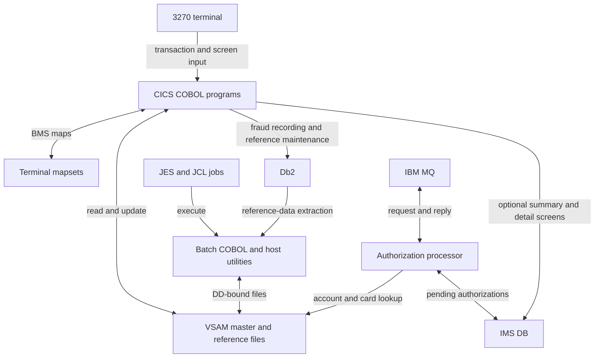
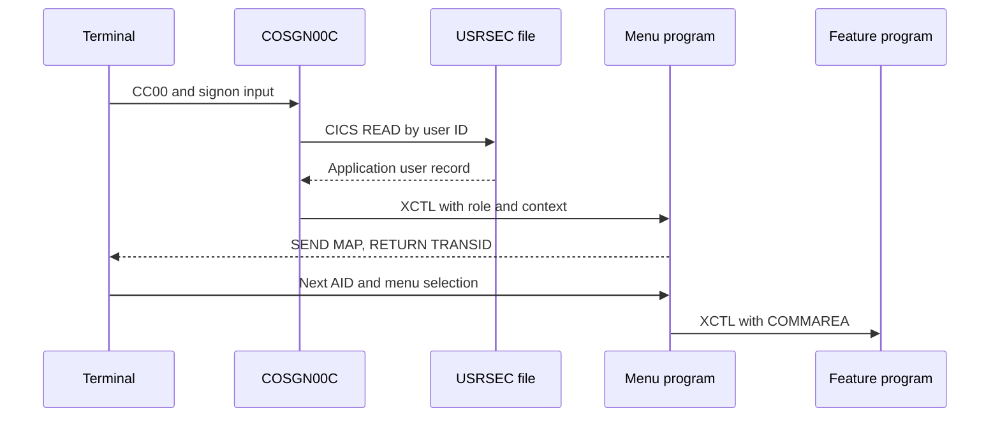

# Architecture

CardDemo has two core execution paths: CICS online transactions and JCL-driven batch programs. They share VSAM records. Optional extensions introduce MQ, IMS, and Db2 without replacing the base storage model (`app/csd/CARDDEMO.CSD`, `app/jcl/POSTTRAN.jcl`).

## Runtime boundaries

The diagram describes checked-in integration points, not an AWS infrastructure deployment. `samples/m2/mf/CardDemo_runtime.zip` and `samples/m2/unikix/UniKix_CardDemo_runtime_v1.zip` are runtime example archives, not provisioning code.

## Online task lifecycle

The signon program checks `EIBCALEN` to distinguish the first invocation, receives a BMS map, reads the application security record, and transfers control to the regular or administrator menu (`app/cbl/COSGN00C.cbl`). This application-level signon is distinct from host RACF security.

`CARDDEMO-COMMAREA` in `app/cpy/COCOM01Y.cpy` carries the user role, navigation context, customer, account, card, and previous map information. `app/cbl/COMEN01C.cbl` copies that area on entry, handles AID keys, and dispatches a selected program. `RETURN TRANSID ... COMMAREA` ends a task while arranging the next terminal interaction.

## Storage and batch

Records are shared contracts, not ORM entities. For example, `app/cpy/CVACT01Y.cpy` defines a 300-byte account record, and `app/cpy/COCOM01Y.cpy` is a transient communication area rather than a persistent table. File names in COBOL, CICS resources, JCL DD statements, and physical dataset names are different names for related resources. Use [Data models](../reference/data-models.md) and [Configuration](../reference/configuration.md) to align them.

`app/jcl/POSTTRAN.jcl` binds daily input, transaction master, account master, cross-reference, category balance, and rejected output to `CBTRN02C`. `app/cbl/CBACT04C.cbl` then uses category balances and disclosure groups for interest calculation. The close/open jobs in `app/jcl/CLOSEFIL.jcl` and `app/jcl/OPENFIL.jcl` define the coordination boundary between online access and batch maintenance. Re-running initialization and posting is not a harmless read operation.

## Optional integrations

- [Authorizations](../systems/authorizations/index.md) documents MQ processing, IMS records, fraud marking, and purge/load tools. The external POS/cloud client is not included (`app/app-authorization-ims-db2-mq/README.md`).
- [Transaction types](../systems/transaction-types.md) explains how Db2 administration feeds VSAM reference data through extraction.
- [MQ inquiries](../systems/mq-inquiries.md) covers the separate date/account responders. Their wire behavior must be read from the programs, not inferred from illustrative README examples.

COBOL is the primary executable language; JCL and procedures drive host tools, BMS defines screens, and assembler supplies host utilities. At this revision, 42 COBOL programs contain 29,106 physical lines, 61 copybooks contain 10,548, and 21 BMS maps contain 5,756. There are also 53 JCL members, six procedures, and two assembler programs. These counts include comments and blank lines, not executable-statement counts; [the statistics snapshot](../by-the-numbers.md) documents classification and collection date. [Patterns and conventions](../how-to-contribute/patterns-and-conventions.md) explains the cross-cutting implementation patterns.
