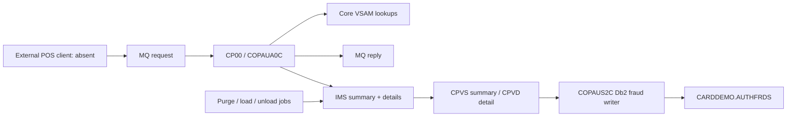

# Authorizations

Active contributors: Arunkumar

[Optional systems](../index.md) · [Architecture](../../overview/architecture.md)

## Purpose

This optional CardDemo module receives card-authorization requests through IBM MQ, reads core VSAM reference data, stores pending authorization summaries and details in IMS, and exposes CICS screens for review and manual fraud marking. Fraud marking additionally writes Db2. It is a host demonstration, not a complete payment network or automated fraud-detection service.

Read the subsystem in this order:

1. [MQ processing, rules, and replies](mq-processing.md).
2. [IMS views and Db2 fraud marking](online-and-fraud.md).
3. [Purge and database utilities](batch-utilities.md).

## Layout

All source paths below are repository-root-relative.

| Directory | Responsibility |
| --- | --- |
| `app/app-authorization-ims-db2-mq/cbl` | Eight COBOL programs: processor, two screens, fraud writer, purge, sequential load/unload, GSAM unload |
| `app/app-authorization-ims-db2-mq/cpy` | MQ request/reply/error layouts, IMS segments, function codes and database/GSAM PCB masks |
| `app/app-authorization-ims-db2-mq/bms` | Summary and detail terminal maps |
| `app/app-authorization-ims-db2-mq/cpy-bms` | Corresponding symbolic maps consumed by COBOL |
| `app/app-authorization-ims-db2-mq/csd` | CICS programs, transactions, mapsets and Db2 plan/transaction association |
| `app/app-authorization-ims-db2-mq/ims` | HIDAM/index DBDs, GSAM DBDs and four PSBs |
| `app/app-authorization-ims-db2-mq/dcl` | SQL declaration and COBOL host variables |
| `app/app-authorization-ims-db2-mq/ddl` | Fraud table and unique index |
| `app/app-authorization-ims-db2-mq/jcl` | Five host jobs for purge and database movement |
| `app/app-authorization-ims-db2-mq/data/EBCDIC` | IMS sample unload artifact; format discussion only in [database utilities](batch-utilities.md#sample-data-and-format-boundaries) |

### Bounded statistics

At the inspected `origin/main` revision `8ca2f60`, this directory has **40 tracked files**, including **8 COBOL program files**, **2 BMS maps**, **9 copybooks**, **2 symbolic maps**, **8 IMS definitions**, **5 JCL jobs**, **2 DDL files**, **1 DCL**, **1 CSD**, **1 sample-data artifact**, and **1 README**. Its path-scoped default-branch history contains **1 unique human committer**, Arunkumar Selvam. This is historical attribution, not a current ownership or reliability metric.

No dedicated automated test files are present in this subtree: **0 test files / 8 COBOL program files = 0% file-count test-to-code ratio**. Fixtures and utility jobs are not counted as tests; this is not runtime coverage. These bounds apply to all three focused pages. Reproduce the file inventory with `git ls-tree -r --name-only origin/main -- app/app-authorization-ims-db2-mq` and contributor attribution with `git log origin/main --format='%cn' -- app/app-authorization-ims-db2-mq`.

## Abstractions and flow

An IMS root is an account summary; its children are authorization details keyed by reverse processing timestamp. The external POS/cloud client shown in the source README's architecture is **not included**. The diagram is a logical flow, not an atomic transaction boundary.

## Integration and limits

- Install the base CardDemo VSAM resources first. The processor reads `CCXREF`, `ACCTDAT`, and `CUSTDAT`; the summary screen also reads account-keyed `CXACAIX`.
- CICS resources associate `CP00` with `COPAUA0C`, `CPVS` with `COPAUS0C`, and `CPVD` with `COPAUS1C`. `COPAUS2C` is linked by the detail program, not a separate terminal transaction.
- Online IMS access uses `PSBPAUTB`; its compatible I/O PCB also explains the purge program's different PCB number. Db2 fraud writes require a working CICS Db2 attachment and bound plan.
- MQ requests and replies explicitly use **NO-SYNCPOINT**. The processor replies **before** updating IMS. Its later CICS syncpoint therefore does not make dequeue, reply and IMS persistence an atomic unit.
- The fraud path issues CICS syncpoint/rollback around linked Db2 work and an IMS replacement. That expresses coordinated-unit-of-work intent, but the checked-in source does not prove installed resource recovery or successful two-phase commit. See the [precise boundary](online-and-fraud.md#syncpoints-and-error-boundaries).
- Queue names in the README are examples, not an installed MQ definition set. The processor obtains the input queue from trigger data and the reply queue from the request descriptor. No complete MQ provisioning or POS client is supplied.
- Host JCL has site-specific library/database names and a literal load-library placeholder. README SQL uses schema/database/storage-group placeholders; executable SQL and DDL instead name `CARDDEMO`. CSD names a sample plan that differs from the README example. Resolve these together rather than treating installation snippets as portable configuration.

## Modification entry points

Change wire fields in processor and request/reply copybooks together. Change persistent layouts in both segment copybooks and DBDs, then revisit screen buffers, SQL mappings and load/unload contracts. Change terminal fields in BMS and regenerate the matching symbolic maps. Review purge behavior before changing retention; the current implementation has important data-loss and accounting caveats.

## Key source files

| Path | Role |
| --- | --- |
| `app/app-authorization-ims-db2-mq/cbl/COPAUA0C.cbl` | MQ processing, decisions, replies and IMS writes |
| `app/app-authorization-ims-db2-mq/cbl/COPAUS0C.cbl` | Summary lookup and paging |
| `app/app-authorization-ims-db2-mq/cbl/COPAUS1C.cbl` | Detail navigation and fraud action coordination |
| `app/app-authorization-ims-db2-mq/cbl/COPAUS2C.cbl` | Db2 insert/update |
| `app/app-authorization-ims-db2-mq/cbl/CBPAUP0C.cbl` | Expiry scan, deletion and checkpoints |
| `app/app-authorization-ims-db2-mq/ims/DBPAUTP0.dbd` | Primary IMS hierarchy |
| `app/app-authorization-ims-db2-mq/csd/CRDDEMO2.csd` | CICS integration |
| `app/app-authorization-ims-db2-mq/README.md` | Intent and installation examples; verify against source |

## Related links

[Core features](../../features/core/index.md) · [Record models](../../reference/data-models.md) · [Host configuration](../../reference/configuration.md) · [Testing limits](../../how-to-contribute/testing.md) · [Security](../../security.md)
