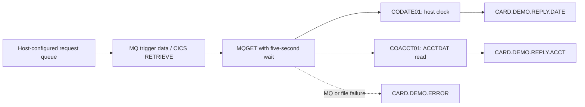

# MQ inquiries

Active contributors: Arunkumar

See [optional systems](index.md), [architecture](../overview/architecture.md), and the separate [authorization subsystem](authorizations/index.md).

## Purpose

`app/app-vsam-mq` supplies two **CICS MQ responders**: one returns host date/time, the other reads an account from VSAM. They are not terminal clients that send requests and display replies, and are not the authorization processor.

Scope: four tracked files under `app/app-vsam-mq` on `origin/main`: two COBOL programs, one CSD member, and one README. The scoped default-branch history has one distinct human committer. No automated tests are present in this scope: test-program-to-COBOL-program ratio **0:2**, not runtime coverage. Historical contribution does not establish current ownership.

## Runtime flow

Both programs open the error queue first, retrieve an MQ trigger message (`CMQTML`) with `EXEC CICS RETRIEVE`, and obtain the input queue name from `MQTM-QNAME`. They open a fixed response queue and repeatedly get/process messages. `MQGET` requests conversion, syncpoint participation, and a **5,000 ms** wait; `MQRC-NO-MSG-AVAILABLE` ends processing. The loop issues a CICS `SYNCPOINT` before the next get, committing the preceding request/reply work on the ordinary path.

`app/app-vsam-mq/csd/CRDDEMOM.csd` maps `CDRD` to `CODATE01` and `CDRA` to `COACCT01`. It defines the two programs, transactions, and a load library—not MQ queue-manager, queue, initiation/process, or CICS-MQ connection resources. Those host prerequisites must be supplied separately. Starting the transaction without retrievable trigger data follows the error path; typing it at a terminal is not the documented source protocol.

## Actual message contracts

The programs allocate **1,000-byte** message buffers and put **1,000-byte, space-padded replies**. They save the inbound message ID, correlation ID, and reply-to queue, but **ignore the saved reply-to queue for routing**: output goes to the fixed queue below. The put restores the inbound `MsgId` and `CorrelId` unchanged, sets `MQFMT-STRING`, and uses the queue-manager CCSID. It does not implement the common “request MsgId becomes reply CorrelId” convention.

| Responder | Request consumed | Response |
| --- | --- | --- |
| `app/app-vsam-mq/cbl/CODATE01.cbl` | Request bytes are copied into a four-character function / eleven-digit key / 985-character filler layout, but neither function nor key is checked. | `CARD.DEMO.REPLY.DATE`: concatenated `SYSTEM DATE : ` + `MM-DD-YYYY` + `SYSTEM TIME : ` + eight-character time, followed by padding. No response-type or request-ID prefix. |
| `app/app-vsam-mq/cbl/COACCT01.cbl` | Bytes 1–4 must be `INQA`; bytes 5–15 contain a positive eleven-digit display account key; bytes 16–1000 are filler. There is **no eight-character request-ID field**. | `CARD.DEMO.REPLY.ACCT`: the local `WS-ACCT-RESPONSE` group, then padding; invalid parameters or a missing account instead produce descriptive text. |

The account read uses CICS file `ACCTDAT`, an eleven-character key, and the `ACCOUNT-RECORD` layout from `app/cpy/CVACT01Y.cpy`. A successful response contains labels alongside account ID, status, balance, credit/cash limits, open/expiry/reissue dates, cycle credits/debits, and group ID. It is not a raw 300-byte account record or JSON.

Amounts in `WS-ACCT-RESPONSE` are `PIC S9(10)V99` display fields, not decimal-edited text. Their decimal point is implied and their sign follows the COBOL display representation. Preserve encoding/sign handling when building a consumer; treating the message as ordinary human-formatted currency loses information.

## Source-backed caveats

- **README mismatch:** `app/app-vsam-mq/README.md` describes terminal requester behavior, generic `CARDDEMO.REQUEST.QUEUE` / `CARDDEMO.RESPONSE.QUEUE` names, and `DATE`/`ACCT` structures with an eight-byte request ID. Those examples do not match these responders' direction, fixed reply destinations, or actual account key offset/function.
- **Length and numeric validation:** the get returns `MQ-DATA-LENGTH`, but the programs copy the whole buffer without using that length to validate the request or clear the buffer before every get. Account validation checks `INQA` and a positive key, not an explicit `IS NUMERIC` test. Use a complete, correctly encoded request layout; do not assume short or malformed messages are safe.
- **Error behavior:** MQ failures and unexpected CICS file responses produce a diagnostic on `CARD.DEMO.ERROR`; a missing account receives a normal text reply. Error puts also use syncpoint options. The source does not provide an explicit rollback/retry/dead-letter policy or an exactly-once guarantee.
- **Cleanup:** close-error branches can call termination again while their open flags remain set. This is not a hardened recovery mechanism; exercise MQ-open/get/put/close failures on the target host before operational use.
- **Data exposure:** responses include account financial fields without an application-level user authorization check in either responder. Queue authority, CICS security, and consumer access must be reviewed separately; see [security](../security.md).

## Modification entry points

Change request parsing in `REQUEST-MSG-COPY` and `4000-PROCESS-REQUEST-REPLY`; change destination routing in startup/output-open logic; change response serialization in `WS-ACCT-RESPONSE` or the date `STRING`. Keep producer/consumer byte offsets, message lengths, CCSIDs, and correlation rules coordinated. A dynamic reply-to protocol requires code changes, not merely setting `MQMD.ReplyToQ`.

Host verification should cover date requests, valid/missing/malformed accounts, two consecutive messages of different lengths, the five-second drain timeout, reply IDs and destination, signed amount decoding, syncpoint/backout behavior, and queue/file failures. These are suggested checks, not checked-in automated tests.

## Key source files

| Source | Responsibility |
| --- | --- |
| `app/app-vsam-mq/cbl/CODATE01.cbl` | Triggered date/time responder, MQ loop and fixed date reply. |
| `app/app-vsam-mq/cbl/COACCT01.cbl` | `INQA` parser, VSAM account lookup, labeled account response. |
| `app/app-vsam-mq/csd/CRDDEMOM.csd` | `CDRD` / `CDRA` program and transaction resources. |
| `app/cpy/CVACT01Y.cpy` | Shared account record read from `ACCTDAT`. |
| `app/app-vsam-mq/README.md` | High-level extension overview; protocol examples require comparison with source. |
