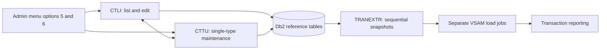

# Transaction types

Active contributors: Arunkumar

See [optional systems](index.md), [architecture](../overview/architecture.md), and [record contracts](../reference/data-models.md).

## Purpose

The optional Db2 module maintains transaction-type reference descriptions through CICS screens or a batch input file. It does not move the core account or transaction stores into Db2. Reporting still reads VSAM reference files; exporting Db2 rows and loading those files are separate operations.

Scope: 27 tracked files under `app/app-transaction-type-db2` on `origin/main`, including three COBOL programs, two BMS maps, their two symbolic maps, two shared copybooks, two DCLGEN members, four DDL members, seven controls, three jobs, a CSD member, and a README. One distinct human committer appears in that scoped default-branch history. No automated tests are checked in within this scope: test-program-to-COBOL-program ratio **0:3** (not measured coverage). Contributor attribution is historical, not a support or ownership guarantee.

## Layout and contracts

| Layer | Contract |
| --- | --- |
| Db2 tables | `CARDDEMO.TRANSACTION_TYPE`: `TR_TYPE CHAR(2)` primary key and `TR_DESCRIPTION VARCHAR(50)`, both non-null. |
| Categories | `CARDDEMO.TRANSACTION_TYPE_CATEGORY`: two-character type, four-character category, and 50-character variable description; composite primary key and parent foreign key with `ON DELETE RESTRICT`. |
| Host variables | `app/app-transaction-type-db2/dcl/DCLTRTYP.dcl` represents the variable description as a binary length followed by `PIC X(50)` text. Preserve both fields when changing SQL or layouts. |
| Online UI | `CTLI` → `COTRTLIC` / `COTRTLI`; `CTTU` → `COTRTUPC` / `COTRTUP`. |
| Batch UI | `COBTUPDT` reads `INPFILE`; action in column 1, type in columns 2–3, description in columns 4–53. Actions are `A`, `U`, `D`, or `*` for a comment. |

The category schema and extracts are supplied, but these three programs maintain the **parent type table**, not a category-maintenance screen. The batch job comment describes a numeric type; its actual host field is `PIC X(2)`, matching the character SQL key.

## Online flow

`app/cpy/COADM02Y.cpy` exposes both programs as admin options. The programs use the shared `COCOM01Y` navigation context plus local COMMAREA state and return to their transaction for pseudo-conversational reentry; see [host conventions](../how-to-contribute/patterns-and-conventions.md).

- **List:** `app/app-transaction-type-db2/cbl/COTRTLIC.cbl` displays seven rows. Forward and backward cursors use key boundaries (`>=` and `<`), ascending/descending order, optional exact type filtering, and SQL `LIKE TRIM(...)` description filtering. The forward reader fetches an extra row to establish whether another page exists. Row actions are `U` and `D`; additions navigate to the maintenance program.
- **Maintenance:** `app/app-transaction-type-db2/cbl/COTRTUPC.cbl` looks up a type, reviews changes through screen state, updates its description, inserts when its update path returns SQLCODE `+100`, and deletes through a confirmation state.
- **Commit and errors:** successful online update/insert/delete paths issue CICS `SYNCPOINT`. Deletes report SQLCODE `-532` when dependent categories prevent removal; the maintenance update path also handles `-911`. These are keyed writes, not an optimistic version-check protocol: inspect concurrent-edit behavior before treating the screens as production maintenance.

## Batch and reporting integration

`app/app-transaction-type-db2/jcl/MNTTRDB2.jcl` runs `COBTUPDT` through `IKJEFT01` and the `CARDDEMO` plan. The program processes rows sequentially, ignores `*` rows, and routes invalid actions or SQL failures to its error termination routine. It contains no explicit SQL `COMMIT`/`ROLLBACK`; do not describe it as committing each input row.

`app/app-transaction-type-db2/jcl/TRANEXTR.jcl`:

1. Backs up existing type and category sequential files into GDGs.
2. Deletes the previous sequential outputs.
3. Uses `DSNTIAUL` to extract ordered **60-byte** records: type + description padded to 50 + eight zero characters; category type + category + description padded to 50 + four zero characters.

The job ends after the sequential extracts. It does **not** reload VSAM. `app/jcl/TRANTYPE.jcl` and `app/jcl/TRANCATG.jcl` provide delete/define/REPRO loading examples; `app/jcl/TRANREPT.jcl` and `app/cbl/CBTRN03C.cbl` consume the VSAM reference stores. The extract's comment says “once a day,” but that comment alone is not an installed schedule or an automatic refresh chain. Reports see changes only after the relevant host export/load sequence completes.

## Setup caveats and modification entry points

- `app/app-transaction-type-db2/csd/CRDDEMOD.csd` supplies maps, programs, transactions, a `DB2ENTRY` for plan `CARDDEMO`, and transaction-to-entry mappings. It is not a complete region/Db2 connection or package-bind installation.
- `app/app-transaction-type-db2/jcl/CREADB21.jcl` is checked in with `TYPRUN=SCAN`. Its controls assume subsystem `DAZ1`, site-specific libraries, storage group `AWST1STG`, and prebound Db2 utilities. Its FREE step can return RC 8 for nonexistent packages/plans; adapt and review the job rather than submitting unchanged.
- `app/app-transaction-type-db2/ctl/DB2CREAT.ctl` includes broad `PUBLIC` grants, including database administration. These are demonstration setup choices, not a least-privilege production policy. See [security](../security.md).
- Change schema, DCLGEN members, SQL, BMS/symbolic maps, and fixed-width extracts together when changing key/description sizes. Rebuild the admin menu caller when changing its copybook; coordinate CSD and package/plan changes with host deployment.
- Validate filter boundaries, empty/end pages, missing/duplicate types, dependent-category deletion, concurrent edits, and extracted record lengths on a provisioned host. No local Db2/CICS test harness is supplied.

## Key source files

| Source | Responsibility |
| --- | --- |
| `app/app-transaction-type-db2/cbl/COTRTLIC.cbl` | Seven-row list, filtering, paging, update/delete, SQL diagnostics. |
| `app/app-transaction-type-db2/cbl/COTRTUPC.cbl` | Single-type lookup, review, insert/update/delete states. |
| `app/app-transaction-type-db2/cbl/COBTUPDT.cbl` | Action-driven batch maintenance. |
| `app/app-transaction-type-db2/ddl/TRNTYPE.ddl`, `app/app-transaction-type-db2/ddl/TRNTYCAT.ddl` | Parent and category schema contracts. |
| `app/app-transaction-type-db2/dcl/DCLTRTYP.dcl`, `app/app-transaction-type-db2/dcl/DCLTRCAT.dcl` | SQL host declarations. |
| `app/app-transaction-type-db2/bms/COTRTLI.bms`, `app/app-transaction-type-db2/bms/COTRTUP.bms` | Terminal layouts; corresponding symbolic maps live in `app/app-transaction-type-db2/cpy-bms`. |
| `app/app-transaction-type-db2/cpy/CSDB2RWY.cpy`, `app/app-transaction-type-db2/cpy/CSDB2RPY.cpy` | Shared Db2 diagnostic storage and formatting routines. |
| `app/app-transaction-type-db2/csd/CRDDEMOD.csd`, `app/cpy/COADM02Y.cpy` | CICS resources and admin menu integration. |
| `app/app-transaction-type-db2/jcl/CREADB21.jcl`, `app/app-transaction-type-db2/ctl/DB2CREAT.ctl` | Site-specific create/load setup. |
| `app/app-transaction-type-db2/jcl/MNTTRDB2.jcl`, `app/app-transaction-type-db2/jcl/TRANEXTR.jcl` | Batch maintenance and sequential exports. |
